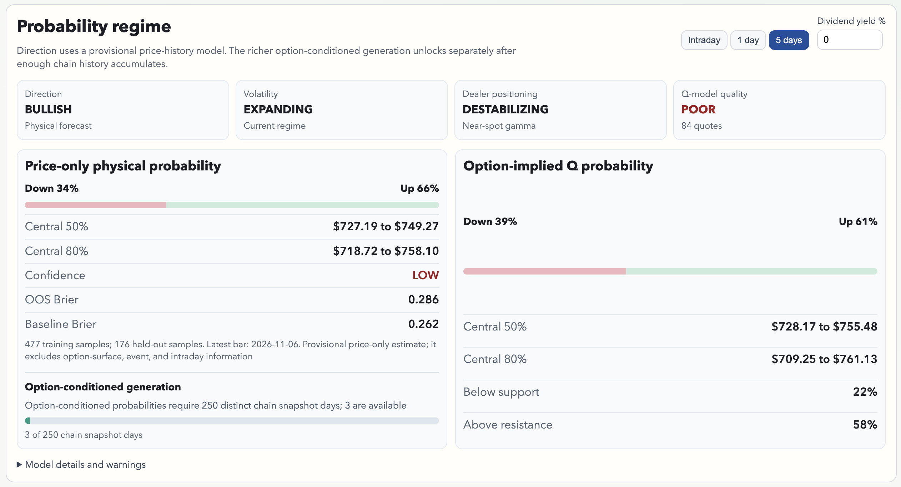
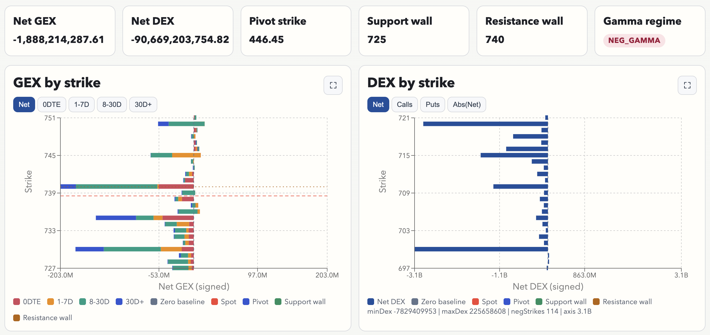
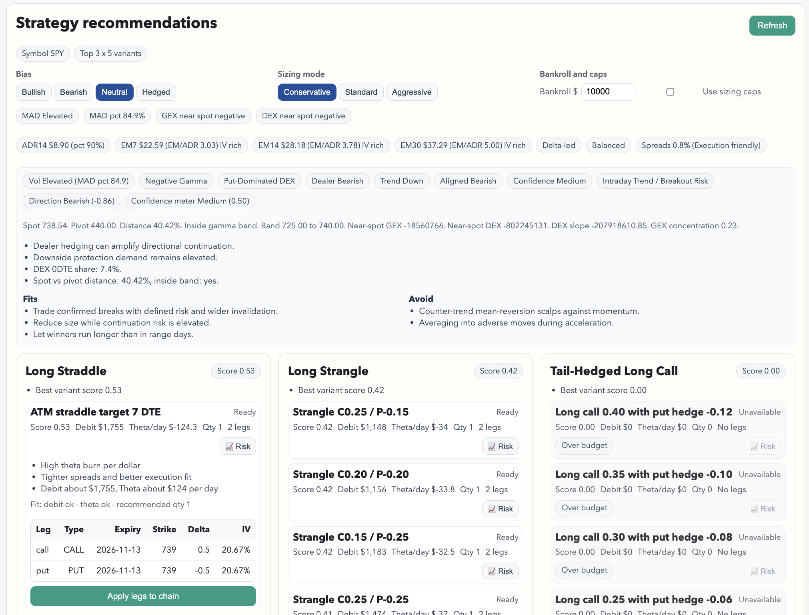
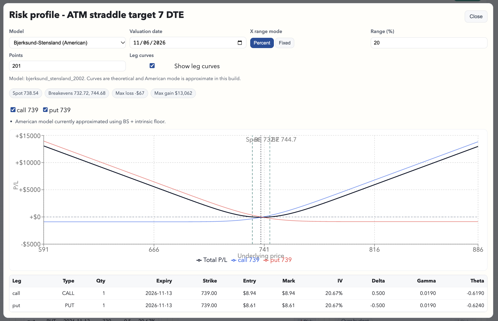

## Projects

### 📈 Volare - Equity options analytics dashboard 
A proprietary equity options analytics dashboard built in Typescript, React, Python (FastAPI), DuckDB and the Thinkorswim API for real-time data.

### 🏀 HoopProps - NBA Player Props Analytics Platform
[HoopProps](https://hoopprops.app) is a data-driven platform for analyzing and pricing NBA player prop bets using historical performance and probabilistic modeling.

## Experience

### Quizlet, San Francisco – **Software Engineer (Full stack)**
*September 2020 – April 2025*

### Slader (acquired by Quizlet), New York City – **Full Stack Engineer**
*December 2014 – September 2020*

### MRY, New York City – **Interactive Developer**
*January 2013 – August 2014*

### Open Hospitality, New York City – **Web Developer (Intern to Full-time)**
*November 2011 – January 2013*

